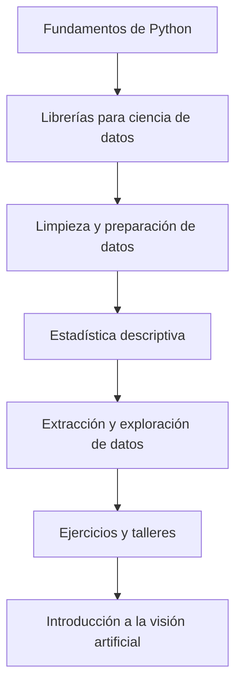

# 📊 Ciencia de Datos con Python | SENA


Repositorio de **materiales de aprendizaje, notebooks y ejercicios prácticos** para explorar los fundamentos de la ciencia de datos utilizando Python. Los contenidos avanzan desde la programación básica hasta la manipulación, limpieza, extracción y análisis de datos, e incluyen ejemplos de visión artificial.

> **Propósito educativo:** facilitar el aprendizaje práctico mediante ejemplos que se pueden estudiar, modificar y ejecutar de forma progresiva.

## 📚 Contenidos

| Recurso | Tema principal | Descripción |
| --- | --- | --- |
| [`01-ConceptosPython.ipynb`](01-ConceptosPython.ipynb) | Fundamentos de Python | Variables, entrada y salida, operadores, condicionales, ciclos, estructuras de datos y funciones. |
| [`02_LibreriasPython.ipynb`](02_LibreriasPython.ipynb) | Librerías para datos | Introducción y ejemplos de librerías como NumPy y Pandas, junto con herramientas de visualización y análisis. |
| [`03-2_Estadística descriptiva.ipynb`](03-2_Estad%C3%ADstica%20descriptiva.ipynb) | Estadística descriptiva | Notebook dedicado a conceptos y ejercicios de estadística descriptiva. |
| [`03_Limpieza_datos.ipynb`](03_Limpieza_datos.ipynb) | Preparación de datos | Prácticas relacionadas con la limpieza y el tratamiento de conjuntos de datos. |
| [`04_Extracción_datos.ipynb`](04_Extracci%C3%B3n_datos.ipynb) | Obtención de datos | Ejercicios de extracción y trabajo con fuentes de datos. |
| [`deteccion-openCv.ipynb`](deteccion-openCv.ipynb) | Visión artificial | Ejercicios de detección con OpenCV. |
| [`deteccion-yolo-cv2/`](deteccion-yolo-cv2/) | Detección de objetos | Material relacionado con YOLO y OpenCV. |
| [`TallerEntendimientoDatos/`](TallerEntendimientoDatos/) | Taller práctico | Recursos para trabajar el entendimiento de datos. |
| `DocumentosNB02/`, `DocumentosNB03/`, `DocumentosNB04/` | Material complementario | Carpetas con recursos organizados por notebook o bloque de formación. |
| [`player_valuations.csv`](player_valuations.csv) | Datos de práctica | Archivo CSV disponible para ejercicios de análisis. |
| [`haarcascade_frontalface_default.xml`](haarcascade_frontalface_default.xml) | Modelo de detección | Clasificador Haar Cascade para ejercicios de detección facial. |

## 🎯 Objetivos de aprendizaje

- Comprender la sintaxis y las estructuras básicas de Python.
- Utilizar bibliotecas para el manejo y análisis de datos.
- Preparar conjuntos de datos para su exploración.
- Aplicar fundamentos de estadística descriptiva.
- Explorar técnicas de extracción de datos.
- Conocer aplicaciones introductorias de visión artificial.

## 🧭 Ruta de aprendizaje sugerida



La ruta es **orientativa**: los notebooks y talleres pueden trabajarse según la planeación de la formación.

## ⚙️ Requisitos previos

- Python 3 con `pip` y el módulo `venv` disponibles.
- Git para clonar el repositorio.
- JupyterLab o VS Code con la extensión Jupyter; alternativamente, una cuenta de Google para usar Colab.
- Conocimientos básicos de programación (recomendados, pero no obligatorios).

> Algunas dependencias, en especial las de visión artificial y aprendizaje automático, pueden depender de la versión de Python y del sistema operativo. Este repositorio no contiene actualmente un `requirements.txt` en la raíz; por eso, se recomienda instalar las librerías necesarias para cada notebook.

## 🚀 Instalación y configuración local

### 1. Clonar el repositorio

```bash
git clone https://github.com/rubisabel00/ciencias-de-datos-Sena.git
cd ciencias-de-datos-Sena
```

### 2. Crear un entorno virtual

El entorno se llamará siempre **`venv`**.

```bash
python -m venv venv
```

**Windows (PowerShell):**

```powershell
.\venv\Scripts\Activate.ps1
```

**Linux o macOS:**

```bash
source venv/bin/activate
```

En algunos sistemas se utiliza `python3` en lugar de `python`.

### 3. Instalar herramientas básicas

```bash
python -m pip install --upgrade pip
python -m pip install jupyterlab ipykernel numpy pandas matplotlib seaborn
```

Para trabajar con ejemplos de aprendizaje automático o visión artificial, instala **solo cuando sean necesarios** los paquetes correspondientes:

```bash
python -m pip install scikit-learn opencv-python
```

Para ejemplos que utilicen la biblioteca `ultralytics`:

```bash
python -m pip install ultralytics
```

> Estas instrucciones ofrecen un punto de partida; **no constituyen una lista exhaustiva ni validada de dependencias para todos los notebooks**. Revisa las importaciones y los archivos auxiliares de cada ejercicio antes de ejecutarlo.

### 4. Abrir los notebooks

```bash
jupyter lab
```

Desde el navegador, abre el notebook que quieras estudiar y selecciona el kernel del entorno de Python activo. También puedes abrir los archivos `.ipynb` directamente en VS Code.

### 5. Desactivar el entorno virtual

```bash
deactivate
```

## ☁️ Ejecución en Google Colab

1. Entra a [Google Colab](https://colab.research.google.com/).
2. Selecciona **Archivo → Abrir cuaderno → GitHub**.
3. Busca `rubisabel00/ciencias-de-datos-Sena`.
4. Abre el notebook que quieras ejecutar.
5. Instala las dependencias adicionales cuando el ejercicio lo indique.

En Colab, los archivos de datos locales del repositorio no siempre están disponibles automáticamente. Si un notebook utiliza un CSV, imagen o modelo auxiliar, súbelo al entorno o ajusta las rutas de acceso.

## 🗂️ Estructura general

```text
ciencias-de-datos-Sena/
├── DocumentosNB02/
├── DocumentosNB03/
├── DocumentosNB04/
├── TallerEntendimientoDatos/
├── deteccion-yolo-cv2/
├── 01-ConceptosPython.ipynb
├── 02_LibreriasPython.ipynb
├── 03-2_Estadística descriptiva.ipynb
├── 03_Limpieza_datos.ipynb
├── 04_Extracción_datos.ipynb
├── deteccion-openCv.ipynb
├── haarcascade_frontalface_default.xml
├── player_valuations.csv
└── README.md
```

## 🧪 Recomendaciones para los ejercicios

- Ejecuta las celdas en orden y revisa las explicaciones antes de modificar el código.
- Trabaja sobre una copia del notebook cuando realices experimentos.
- Comprueba las rutas a archivos CSV, imágenes y modelos.
- Documenta tus observaciones y resultados en celdas Markdown.
- No subas datos personales, credenciales ni archivos de grandes dimensiones sin necesidad.
- Si compartes cambios, evita incluir la carpeta `venv/` en Git.

## 🛠️ Herramientas y tecnologías

**Lenguaje y entornos:** Python, Jupyter Notebook / JupyterLab y Google Colab.

**Análisis y visualización:** NumPy, Pandas, Matplotlib y Seaborn.

**Temas complementarios:** estadística descriptiva, limpieza y extracción de datos, OpenCV y detección de objetos con YOLO. Algunas librerías y temas se utilizan solo en actividades específicas.

## 🤝 Contribuciones

Para proponer una corrección o una nueva práctica, puedes abrir un *issue* o enviar un *pull request*. Procura explicar el objetivo del cambio y las dependencias necesarias para reproducirlo.

## 👩‍🏫 Contexto académico

Material orientado al aprendizaje de **ciencia de datos con Python** en un contexto de formación del **SENA**. Los ejercicios tienen fines educativos y pueden adaptarse a distintos niveles de aprendizaje.

**Repositorio:** [rubisabel00/ciencias-de-datos-Sena](https://github.com/rubisabel00/ciencias-de-datos-Sena)

## 📄 Licencia

No se identificó un archivo de licencia en la raíz del repositorio al momento de la revisión. Si deseas permitir la reutilización y distribución del material bajo condiciones claras, agrega un archivo `LICENSE` con la licencia que elijas.
